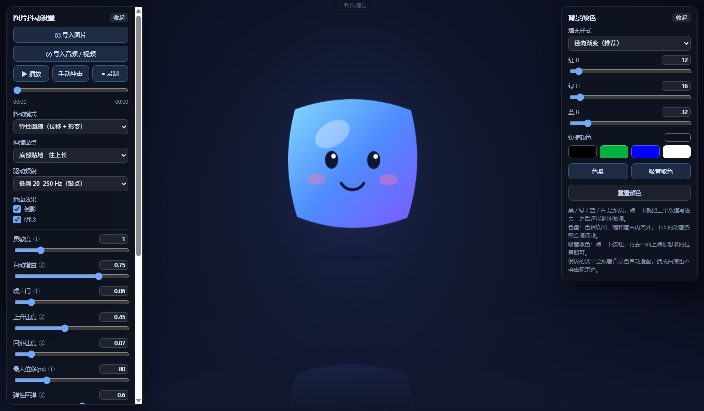

# 音频Q弹化工具箱 · v1.0.0

导入一张图片和一段音乐，让图片跟着节奏 **Q 弹** 起来。

**单文件网页，零依赖、零安装** —— 一个 HTML 就是全部。双击打开即可用，不联网、不上传，所有处理都在你自己的浏览器里完成。

---

## 这是什么

一个把音频变成"物理力"的小工具。它实时分析音乐的能量，驱动图片做**弹性形变**：鼓点一来往上弹、拉长，回落时又压扁回缩，像一块有弹性的橡皮。

和一般的频谱动画不同，这里管画面的是**弹簧物理模型**而不是直接映射——所以动起来有惯性、有回弹、有阻尼收敛，而不是生硬地跟着数字跳。

---

## 功能

### 音频驱动

| 模式 | 效果 |
|---|---|
| **弹性回缩**（推荐） | 有位移也有形变：向上冲时拉长，回落时压扁回缩 |
| **原地伸缩** | 位置锁死不动，只有高度在涨缩 |
| **刚性跳跃** | 只有上下位移，不变形 |
| **逐行波浪** | 图片切成 28 条横带，按延迟取样，形成一道自下而上穿过的波 |

- **伸缩锚点**可选底部贴地 / 中心固定 / 顶部固定，决定形变时哪条边不动
- 拉伸和回缩**分开调节**，可以只拉伸、只压缩，或压得比原图还矮

### 音频分析

- **驱动频段**可选：低频 20–250Hz（鼓点）/ 全频 / 中高频
- **自动增益**：按近期峰值归一化，换歌不用重调灵敏度
- **噪声门**：安静段落彻底不动，避免细碎噪声让画面乱抖
- **非对称包络**：上升快、回落慢 —— 这是"打击感"的来源
- 参数与帧率无关，60Hz 和 144Hz 屏幕手感一致

### 图片与背景

- 点击或**拖拽**导入图片，连续换图不会卡住
- **背景自由调色**：RGB 滑块 + 黑 / 绿 / 蓝 / 白 快捷色
- **色盘取色**（色相绕圈、饱和度由内向外 + 独立明度）
- **吸管取色**：直接从画面上的图片里吸颜色
- 填充样式可选径向渐变 / 纯色平涂
- **倒影、阴影独立开关**，倒影的淡出会自动适配背景色（白底也不会出黑边）

### 参数控制

11 个参数，每个都能**拖滑块**或**直接键入数值**（`↑↓` 也可微调），鼠标悬停 / 点按参数名旁的 **ⓘ** 有说明。所有设置自动存进浏览器，下次打开还在。

### 导出

点「录制」即可把画面和声音一起录下来：

- **优先 MP4**（H.264 + AAC），浏览器不支持时自动退回 WebM
- 8 Mbps 视频码率，录完直接下载

### 双端自适应

- **桌面 / 平板**：左右两块浮动面板
- **手机（≤560px）**：自动变成**底部标签栏 + 抽屉**，标签切换「抖动设置」/「背景颜色」，再点一次当前标签收起抽屉、让出整个画面

---

## 快速开始

1. 下载 `index.html`
2. 用 **Chrome / Edge** 双击打开（Firefox 也能用，但导出只有 WebM）
3. 点 **① 导入图片**、**② 导入音频 / 视频**
4. 点 **▶ 播放**

手机上直接访问部署好的网址即可，交互会自动切换成底部标签布局。

**快捷键**：`空格` 播放 / 暂停 · `K` 手动冲击 · `H` 收起两侧面板 · `Esc` 取消当前操作

---

## 参数速查

| 参数 | 默认 | 说明 |
|---|---|---|
| 灵敏度 | 1.00 | 总幅度开关，配合自动增益使用最稳 |
| 自动增益 | 0.75 | 按近期峰值归一化，换歌免调；调 0 走原始响度 |
| 噪声门 | 0.06 | 低于此强度按静音处理 |
| 上升速度 | 0.45 | 越大起跳越干脆，过大显得神经质 |
| 回落速度 | 0.07 | 越小余韵越长，过大画面干瘪 |
| 最大位移 | 80 px | 上下移动距离，同时放大形变幅度 |
| 弹性回弹 | 0.60 | 惯性大小；0 = 平滑跟随不回弹 |
| 拉伸强度 | 0.14 | 向上冲时拉长多少；0 = 只压缩不拉伸 |
| 回缩强度 | 0.24 | 回落时压扁多少 |
| 微旋转 | 1.5° | 缓慢正弦摆动，给画面一点生命感 |
| 光晕强度 | 0.50 | 背景随音乐呼吸的蓝光（**白底上看不出来**） |

---

## 浏览器要求

| 浏览器 | 使用 | 导出 MP4 | 导出 WebM |
|---|---|---|---|
| Chrome / Edge（较新） | ✅ | ✅ | ✅ |
| Firefox | ✅ | ❌ | ✅ |
| Safari | ✅ | ✅ | ⚠️ |

全部基于浏览器原生能力（Web Audio API、Canvas 2D、MediaRecorder），**没有任何第三方库**，也不需要构建步骤。

---

## 已知限制

- **从视频读音频是测试功能**：支持 MP4 / MOV / WebM，但取决于视频的音轨编码。AAC 没问题，AC-3 / DTS / ALAC 这类浏览器解不了，会给出明确提示。导入视频时会弹一次测试功能提醒。
- **白底上光晕不可见**：光晕用的是加亮混合，在纯白上等于无效，不是故障。
- **移动端 Safari 录制支持不佳**：`canvas.captureStream()` + `MediaRecorder` 在 iOS 上不稳定。
- **手机横屏**会走桌面布局，此时面板偏挤但可滚动。

---

## 制作

| 角色 | 成员 |
|---|---|
| 策划 | [C·T](https://space.bilibili.com/411612864) |
| 项目管理 | [瀚海](https://space.bilibili.com/441027641) |
| 代码实现 | dsh |

---

## 许可

未指定许可证前，默认保留所有权利。若需开源，建议补一个 `LICENSE` 文件（例如 MIT）。
